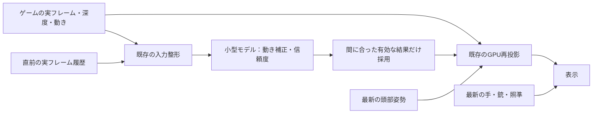

# FPS用モデルの具体案

2026-11-06。優先順位は「画質と操作遅延を保ち、安定して滑らかにする」。
新しいフレーム予測・動き補正モデルはオフ。既存の中央部SRはNPUで動作しており、
すべてのNPU処理が無効という意味ではない。以下は実装・検証の計画であり、70fps達成の報告ではない。

## 2026-11-07の優先目標と現在の処理内訳

現在は[新しい実ゲーム画像で45FPSを目指す工程](FPS_45_PLAN.md)を優先する。
Appleの補正は体感を助けている可能性という補足にとどめ、実FPSには加算しない。
直近の計測済み通常プレイは新しいゲーム画像37.11FPSで、45FPSには未達。
`runs/20261107T021201Z-vxmac-fps-705dc8bf/result.json` のo1/d1。

表示頻度の予算を変更した現在の構成で、4窓16フレームのGPU内訳が検証を通った。
`runs/20261107T015931Z-current-gpu-workload/result.json` のo1〜o4/d1。
重複区間を配分した値は、ゲーム側の描画15.259ms・計算8.975ms・転送0.438ms、
表示・補助側4.482ms。GPUの排他的実行時間や、そのまま回収できる時間ではない。
前の構成との同一場面の交互比較でもないため、差を効果率にしない。

ゲームの重いcomputeグループはライブラリ指紋で区別できるが、画面効果や入出力契約は未特定。
最上位の9ライブラリを含む同時実行グループは配分値2.984ms、
次の直列グループは1.488msだった。モデルへ移す前に、入力・出力・履歴依存を特定する。

上限だけを60へ緩めた別区間は33.17FPSで、上限による待ちは0だった。
`runs/20261107T022550Z-vxmac-fps-7b987229/result.json` のo1/d1。
37.11FPSの区間とは同一場面の交互比較ではなく、退行・改善の原因は未確定。起動設定は45へ復元済み。
次は計算用reflectionと3フレームの資源バインド記録を使い、上記ライブラリの読み書き先・寸法を照合する。
元ゲームのファイル、シェーダー本体、画質・解像度を変更する工程ではない。

3枚の実機記録で上位9ライブラリすべてと照合できたが、全てが中身の空のstructとして
reflectionされるargument bufferを使い、間接dispatchだった。
したがって通常のreflectionだけでは、モデルの入力画像・出力先を指定できない。
encoder単位の資源宣言をkernel単位の入出力へ読み替えず、未解決として記録する。
次は既存のshared bufferのGPUアドレス追跡と、公開されているtexture資源IDを使い、
小さく制限した引数レイアウトの観測と実際の資源を照合する。通常プレイでは記録しない。
対応が取れた処理について初めて、GPUの教師出力、画像差、転送を含むNPU時間を比較する。
この段階で新モデルの有効化・画質低下・FPS向上の主張は行わない。

資源の対応調査では、Appleの[バインド形式の説明](https://github.com/apple/game-porting-toolkit/blob/main/docs/metal-shader-converter/binding-model.md)を参照する。
rootのポインターは64bitのGPUアドレス等、descriptor tableの要素は
GPUアドレス・texture資源ID・付帯情報の3個の64bit値という形式が公開されている。
ただしroot内の定数・table位置はroot signature次第なので、8byteごとの値を全部ポインターと決めつけない。
同社の[reflectionの説明](https://github.com/apple/game-porting-toolkit/blob/main/docs/metal-shader-converter/reflection.md)では、
オフラインのreflectionが配置の根拠になる。版の異なるデータの復号も避ける。
次の観測は、対象9ライブラリに限定し、既知のshared bufferの範囲内の小さな数値と
実際のtexture資源IDだけを照合する。GPU完了待ち・全画面のCPU読戻し・シェーダー改変は加えない。
IDの一致だけで読み書きの意味まで確定せず、配置の根拠が得られないものは未解決のまま残す。
この記録だけから既存モデルの重みを書き換える対象や、NPU化の利益は断定できない。

先に、参照先がない場合の前画像コピーを削る候補を独立検証する。
動きパケットがある場合と補間モードでは履歴を維持し、通常経路の画像数・解像度・
手と銃の計算は保つ。これは依存関係による転送削減で、モデルの成果として扱わない。
高解像度復元モデルの比較では、同じ出力寸法に加え、画質と表示時刻、
GPUとの受け渡しを含む全体の時間を採用条件にする。

## 現在の優先方針：生成と表示の分離を先に検証する

動き補正モデルと固定拡大処理の分担試験は、下記の通り採用条件を満たさなかった。
次は新しいモデルを重ねる前に、加工中の画像を表示へ公開せず、完成済み画像で表示を続ける
固定枚数の基盤を検証する。[実装・検証の範囲](FRAME_PIPELINE.md) を参照。
R1や追跡結果を遅らせることは前提にしない。背景に許す遅延と、頭・手・入力の時刻は区別する。
既存のゲーム経路にも3枚の保存と独立した表示処理があるため、全画面コピーを重複させない。
この基盤の後に、GPU負荷を減らす高解像度復元、次に背景の中間フレーム生成を比較する。
以下の小型動き補正モデル案は、比較用の過去の試作として保持する。

その後、追加遅延0の所有権管理をゲーム経路へ接続し、ユーザーから前の版と同程度の操作という報告を得た。
次は [GPU処理内訳の計測](GPU_WORKLOAD.md) で、復元へ置き換える対象を選ぶ。
初回のM2実記録は回収したが、未実行の描画ステージに過去の時刻が混入していたため、
処理時間の内訳は棄却した。v3では4窓16フレームが実行範囲の照合を通った。
ゲーム描画15.958ms・計算8.559ms・転送0.400ms・表示側16.136msという配分値を得たが、
待ちと複数回の表示更新を含む診断値であり、FPSや削減可能時間ではない。
まず表示・補助処理の名前を特定し、同じ画像を保つ再利用・実装改善とNPU復元を比較する。
ユーザーの体感では一つ前の方が滑らかだったため、次の起動はGPU計測を外す。
NPUでの改善効果はまだ未確認で、モデルも有効にしていない。
その後、v4で動きの集計 `vm` と深度を使う表示 `vxw_gather_depth_fs` などを特定した。
まず集計値を変えずに読み込みを並列にする候補を比較している。
[集計の比較試験](VELOCITY_PREFETCH.md) はMacとM2で70ケースの数値一致を確認した。
M2の単体比較は1.128418msから0.533388ms。試験設定でゲームにも入れたが、
ゲーム全体のFPS・入力遅延・画質の改善は未確認。
NPUモデルは無効のままで、このGPU集計の改善をモデルの成果とは扱わない。
単にNPUの利用量を増やすことや、計算スレッド数だけから削減可能時間を推定することは採用条件にしない。

## 17fpsから70fps表示という目標

実フレームが17fpsなら間隔は約58.8ms、70fps表示なら約14.3ms。
次の実フレームが届くまで、概ね14.3 / 28.6 / 42.9 / 57.1ms先の表示が必要になる。
表示を補う仕組みと、ゲームの物理・当たり判定・操作受付の更新頻度は別々に測る。
補助映像を増やしても、ゲーム自身の更新頻度が自動的に70Hzになるわけではない。

将来の操作、突発的な発砲、未観測の物体の出現は、過去映像と部品だけでは一意に確定しない。
高精度を評価する対象と、予測を使わない領域を定義する。誤った弾道や標的を表示して
滑らかさの数字だけを増やすことは採用条件を満たさない。

## 採用候補：動きと信頼度だけを推定する小型モデル

ゲームが描いた映像、深度、動き、直前の履歴を使い、モデルは動きの小さな補正と信頼度を出す。
色は実際に描いた現在・過去の映像から取得する。未観測部分を生成した色で埋める経路は初期案に含めない。
頭部姿勢は表示直前の値で再投影する。手・銃・照準・HUDを予測背景から分離する必要があり、
現在の部分的な前景処理だけで完全に分離できていると扱わない。

初期の設計値。実機の測定で変更する。

- 入力解像度：256×144、FP16、16チャンネル。
- 入力：現在のRGB、現在位置へ投影した直前RGB、双方の深度と動き、履歴の有効性、
  履歴の経過時間、予測する時間幅、前景の除外マスク。
- 構造：3段の小さい畳み込みネットワーク。幅16 / 24 / 32を出発点とする。
  出力は動きの補正2チャンネルと信頼度1チャンネル。言語モデルは使用しない。
- 補正幅を有界にし、非有限値・深度不一致・不確かな領域は既存の再投影へ戻す。
- モデルは実フレームごとに最大1件を処理し、表示時刻ごとの移動量はGPUで計算する。
  70回/秒の巨大な推論を前提にしない。
- 表示側は推論を待たない。期限を過ぎた結果や別フレームの結果を混ぜない。
  この非同期・最大1件の基盤は既にある。整形・履歴参照の追加コストは別途測定する。

数値だけのルーティングは第二候補。まず閾値で「補正を使う／既存の再投影を使う」を比較する。
モデル化するなら、実測した処理時間・画像誤差・期限超過を教師にする。
ルーター自体がゲームの任意のGPU命令をNPUで実行できるようにするわけではない。

## SSDのゲーム部品を教師データにする工程

部品ファイルから、時間的に連続した正解データを自動生成する方針は可能。
人間の長時間プレイを主なデータ収集手段にする必要はない。
一方、静的なメッシュやテクスチャだけでは「この映像の次」を教える組にならないため、
次のオフライン生成工程が必要になる。

1. 所有するSSDのデータを読み取り専用で調べる。メッシュ、材質、テクスチャ、骨格、
   アニメーション、配置情報を読み込む。現在の武器用ツールは数値・部品検査までであり、
   完全な材質・背景・アニメーション用レンダラーは未実装。
2. 部品をシーンへ配置し、カメラ・物体・照明の軌道を固定した乱数種で動かす。
   手前と奥の交差、細線、反射、影、急な回転、遮蔽の解除を含める。
3. 同じ時系列から、RGB、深度、動き、物体ID、有効性マスクと正確な時刻を出力する。
   入力をt-1 / t、正解をt+14.3 / 28.6 / 42.9 / 57.1msなどとして作る。
   ゲームの実フレーム間隔の揺れも合成する。
4. 背景の動き予測はtの基準カメラで評価し、未来の頭部入力を既知として学習させない。
   プレイヤーの操作で変わる物体には、利用可能な操作・状態を条件として与えるか、
   予測対象から除外する。後から生まれる乱数や未確定入力を正解の手掛かりに混ぜない。
5. 部品・シーン・軌道単位で学習用と評価用を分ける。隣接フレームだけを分けた評価は使わない。
   簡易レンダラーと実ゲームの材質・光・透明物・TAAの違いは、別の実機データで検証する。
   既に学習に使った2026-11-01の記録は独立した最終評価データに数えない。

抽出物、合成映像、モデル重みはローカルの無視対象ディレクトリへ置く。
オリジナルのゲームファイルは変更せず、実装コードとゲーム由来のデータを分ける。

最初の試作は、少数の部品・3種類程度の照明・カメラの直進／横移動／回転を組み合わせ、
100クリップ・約1万組の時系列データを設計上の目安にする。部品単位で評価用を残す。
まず動きと遮蔽の正解が整合することを確認し、単純な再投影と比較してからデータ量を増やす。
この量で必要な精度が得られるという見積もりではない。学習時間と生成時間は未測定。

## 既存モデルから引き継ぐもの

- 引き継ぐ：入力の取り出し、Core MLとの受け渡し、最大1件の非同期処理、
  フレーム番号による結果照合、実機統計、再投影の比較基準。
- 現在のrun3/run4は出力層の特徴重みがゼロ。run1も調べた入力で最終特徴が不活性。
  そのまま初期値として再利用する前に、特徴が出力層へ届くことを検査する。
- `tools/interp_health.py` は所有する既存モデルとキャプチャを読み、最終特徴の生存を調べる。
  `train2` も学習開始前に同じ検査を行い、不活性・非有限の特徴を持つ初期値で進めない。
  検査は重みの修復や画質向上を意味しない。元の重みとアプリのモデル設定は変更しない。
- 最終特徴を修復する実験と、新しい小型モデルの学習を分けて比較する。
  初期値・変更した層・入力・結果のハッシュを残す。

## 採用までの順番

| 段階 | 出力 | 通過条件 |
|---|---|---|
| 0 | 既存モデルの生存検査、単純再投影の基準 | 不活性なモデルを検出し、元の重みを保持できる |
| 1 | 少数の合成シーンと連続した教師データ | RGB・深度・動き・時刻・遮蔽が整合し、同条件で再生成できる |
| 2 | 小型の動き／信頼度モデル | 未学習の部品・軌道でも基準より改善し、時間方向のちらつきが増えない |
| 3 | Vision Pro単体の推論試験 | 演算配置、整形→推論→利用までのp95/p99、メモリ・GPU競合を測定する |
| 4 | 有効／無効を交互に比較 | 実フレーム率、表示期限、操作遅延、照準・細部・遮蔽の品質で悪化がない |

「70fps相当」は段階4の検証目標。現在達成済みの値でも、すべての場面での保証値でもない。
実フレーム率・表示更新・入力から反応までの時間を別々に記録する。

## 2026-11-06の試作状況

`tools/interp_guide.py` に独立した未学習の候補を追加した。入力16／出力3チャンネル、
12,843パラメータ。画像依存の特徴と勾配、補正量の上限、渡された除外マスクによる
出力停止を4件のテストで確認し、Core ML形式への変換が通った。
これは教師データで学習したモデルでも、実機の性能・画質評価でもない。

現在のアプリは入力6／出力6チャンネルを前提にしており、そのまま置換できない。
新しい受け渡し方式、前景の分離、1回の推論結果から異なる表示時刻の動きを
求める方法は実装前に検証する。合成教師データの完全な生成器も未実装。
現在の完成版、元のモデル重み、アプリ設定はこの試作では変更していない。

その後、実メッシュを固定形状の小物として扱う限定的な生成器を実装し、384組で初回学習を行った。
重みを固定後、別部品の128組でも評価した。モデルは単純な遮蔽物との合計では改善したが、
実メッシュ部分だけでは学習なしの加速度予測に届いていない。
M1 MaxでのCore ML試験も、Neural Engineを使う設定がCPUのみより速い結果にはなっていない。
現候補はゲームへの採用条件を満たさない。[詳細な結果・再現手順](NPU_PILOT_RESULT.md) を参照。

GPU支援としての別試験も行った。同じ固定拡大処理をGPUだけ／CPU＋Neural Engineへ分担する構成で比較し、
M1 MaxとM2搭載Vision Proの両方で出力・フレーム番号を検査した。
今回の対象では安定した速度上の利点がなく、不採用。[分担試験の結果](NPU_OFFLOAD_RESULT.md) を参照。
実ゲームのFPS改善を測定した試験ではない。

共同開発向けの論点と採用条件は [相談用RFC案](NPU_RFC_DRAFT.md) にまとめた。
ローカルの試作方針と、コミュニティで合意した製品方針は区別する。

## 一次資料

- [GameNGen](https://arxiv.org/abs/2408.14837) は過去フレームと操作列を条件とする次フレーム予測。
  記録したゲームの軌跡で学習しており、静的な部品を直接読ませただけの例ではない。
- [Armの教師データ生成ガイド](https://github.com/arm/neural-graphics-model-gym/blob/main/docs/nss/nss_data_capture_guide.md)
  は高解像度の正解映像と対応する深度・動きなどの整合を重視している。
- [AppleのCore ML性能測定](https://developer.apple.com/documentation/coreml/analyzing-a-core-ml-model-s-performance-in-xcode)
  で演算配置と推論時間を確認する。計算計画だけで実時間の改善を判断しない。
