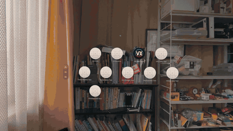

# VXpro



**Play the Mac App Store edition of Cyberpunk 2077 in 3D VR on Apple Vision Pro.** A Mac prepares and installs your game. Once installed, the game runs on the headset without streaming.

[Setup guide](docs/VISION_PRO_CYBERPUNK_MAC.md) · [Video](https://youtu.be/Tn9hQm-S7Ho) · [Discord](https://discord.gg/h2znwYJt3) · [日本語](README_ja.md) · [简体中文](README_zh-Hans.md) · [繁體中文](README_zh-Hant.md) · [한국어](README_ko.md)

VXpro is an experimental preview. The GIF is from a local headset test build.

## What you need

| | Requirement |
| --- | --- |
| Vision Pro | Developer Mode enabled and paired with Xcode. The performance results below are from an M2 headset. |
| Mac | Apple silicon, Xcode 26 or later with the visionOS SDK, XcodeGen and Python 3. |
| Signing | An Apple Developer Program team signed into Xcode. The tested setup uses a paid team for Increased Memory Limit and Extended Virtual Addressing. Personal Team signing has not been verified. |
| Game | Your purchased Mac App Store copy of Cyberpunk 2077, installed on the Mac. Game builds **2.5.0** (shown as **1.0.4** in the Mac App Store) and **2.3.2** were tested. Steam and GOG copies are outside the tested setup. |
| Free space on Vision Pro | About **85 GB** for 2.5.0 or **160 GB** for 2.3.2 with all voice packs. |
| Input | A Joy-Con pair is the tested setup for tracked-hand controls. |

## Install

The public setup builds from source. The Mac GUI installer is being developed [on a separate branch](https://github.com/Ag3497120/VXpro/tree/feat/macos-installer). Public downloads will appear on the [Releases page](https://github.com/Ag3497120/VXpro/releases) when available.

1. Install the game on your Mac. Install the visionOS SDK in Xcode, sign in with your developer team, and pair your Vision Pro.
2. Run the commands below from Terminal. Set `game` to your installed game path and replace `YOUR_TEAM_ID` with your Apple Developer team ID.
3. Keep the headset awake until the initial game-data transfer finishes. Start with the **1280×720 native** profile in the [graphics setup guide](docs/VISION_PRO_CYBERPUNK_MAC.md#recommended-settings).

```sh
git clone https://github.com/Ag3497120/VXpro.git
cd VXpro
game="/Applications/Cyberpunk2077.app"

python3 tools/vxmac_cyberpunk.py doctor --game "$game"
python3 tools/vxmac_cyberpunk.py prepare --game "$game" --team YOUR_TEAM_ID
python3 tools/vxmac_cyberpunk.py build
python3 tools/vxmac_cyberpunk.py install
python3 tools/vxmac_cyberpunk.py copy
python3 tools/vxmac_cyberpunk.py launch
```

> To update an existing install, keep the same bundle ID and signing team. Deleting VX Mac Host also deletes its local saves and copied game data. Back up saves before changing the installation.

## Playing in VR

- **Controller mode** uses the game's standard weapon handling. VR head tracking stays active.
- **Joy-Con-assisted hand tracking** makes the in-game arms, hands and weapons follow your wrists. Joy-Cons still handle movement, firing and other button inputs. In gameplay, hold **+ and − together for one second**, then release both to switch between modes. [Tracked weapon setup and controls](docs/DESIGN.md#experimental-tracked-hand-weapon-hold)
- **Direct CDPR cross-progression** is opt-in. Sign-in, downloading and loading a cloud save were confirmed on Vision Pro. Uploading a new save and loading it on another device remain unverified. [Setup and test status](DIRECT_CLOUD.md).

## Performance and known limits

A 60-second Phantom Liberty session on M2 averaged **37.1 new game images per second**. That run predates the latest camera and input changes. Performance varies by scene and settings. **45 FPS remains a target.** Display refresh and reprojection are separate from the game's frame rate. [Measurement details](docs/RELEASE_2026_11_08.md)

- Rectangular borders can still appear during some vehicle and story scenes. The walking head-turn rebound fix was confirmed in a headset test.
- Tracked weapon alignment, scope lenses, sleeves and reload animations vary by weapon. The tested setup used a locally generated weapon catalog and a reload overlay built from the owner's game files. The public fallback covers fewer weapon-specific interactions.
- On 2.5.0, bundled English audio works. Additional voice packs are unsupported. Menus and subtitles support the game's available languages.
- Eye-tracked foveated rendering is disabled. No FPS gain from the Neural Engine experiments has been established.

## Troubleshooting

If the image smears while turning your head after changing graphics settings, start with **1280×720 native** and turn off motion blur, resolution scaling, dynamic resolution and frame generation. The detailed recovery profile is below.

<details>
<summary>Detailed graphics recovery settings</summary>

Check the game's **Video / Graphics settings** if the picture becomes blurred, head turns leave a strong smear,
or performance changes after adjusting graphics options. Replacing or rolling back the app does not necessarily
restore the settings saved inside its container.

The November 8 audit found the following differences. Restoring the low-effects profile without changing the app
was followed by the user's confirmation that picture quality and head motion had returned to the previous state.

| Setting | Observed during the regression | Recovery baseline |
| --- | --- | --- |
| Output resolution | 1280×720 | **1280×720 native** |
| Resolution scaling / dynamic resolution / frame generation | Off at the audited launch | **All Off** |
| Motion Blur | High | **Off** |
| Film Grain / Chromatic Aberration / Depth of Field | On | **All Off** |
| Texture Quality | High | Low |
| Screen Space Reflections | Ultra | Off |
| Ambient Occlusion / Contact Shadows | High / On | Off / Off |
| Shadow Mesh / Cascaded Shadows / Distant Shadows | High | Low |
| Local Shadows | High | Off |
| Volumetric Fog / Volumetric Clouds | Ultra / Ultra | Low / Off |
| Subsurface Scattering / Maximum Dynamic Decals / Level of Detail | High / Ultra / High | Low / Low / Low |
| Color Precision / Anisotropic Filtering | High / 16× | Medium / 4× |
| Mirror Quality / Crowd Density / Facial Tangent Updates | High / High / On | Low / Low / Off |
| Field of View | 110 | Keep 110 |

**MetalFX is not established as the sole cause.** At that audited launch, `ResolutionScaling` was `Off` and no
temporal-scaler encodes were recorded, even though the saved MetalFX quality option said `Quality`. The restored
file says `Performance`, but that sub-option is inactive while scaling is off; enabling MetalFX Performance is
**not** the recovery instruction. A separate earlier capture had 1280×720 output with an **853×480 internal surface**,
so the output-resolution label alone does not establish native rendering.

Use the in-game menus to apply this baseline. For an external edit, save and quit the game first, back up your own
`Library/Application Support/CD Projekt Red/Cyberpunk 2077/UserSettings.json` from the host's app container,
and change only graphics/crowd options. Preserve other settings, saves and account data. Restart and check the
settings again; do not delete VX Mac Host to reset graphics.

This is a **recovery baseline, not a complete snapshot of the historical 37.1 FPS test or a promised frame rate**.
VR-only blackouts remained after the settings recovery and were addressed separately by the camera fix described
in the [November 9 checkpoint](docs/RELEASE_2026_11_09.md). Vehicle/story borders also need separate diagnosis.

</details>

For setup failures, include your Mac chip, headset model, visionOS version, Cyberpunk build and the step that failed. Remove account details from any logs. [Open an issue](https://github.com/Ag3497120/VXpro/issues) · [Ask on Discord](https://discord.gg/h2znwYJt3)

## How it works

VX Mac Host loads the game's ARM64 code using compatibility shims for macOS APIs. Metal hooks read the game's depth and camera data for stereo rendering, and ARKit wrist tracking drives the existing arm and weapon skeletons. See the [runtime design](docs/DESIGN.md), [hand-tracking notes](HAND_SESSION.md) and [main branch checkpoint](docs/RELEASE_2026_11_10.md). The related [VeRantyx project](https://github.com/Ag3497120/VeRantyx) covers the Windows and Steam VR route.

VXpro's source is MIT licensed. Setup prepares and signs the game locally using your own purchased copy. Game binaries, assets and compiled overlays stay on your devices. VXpro is an independent project. [License](LICENSE) · [Third-party notices](THIRD_PARTY_NOTICES.md)
