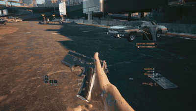
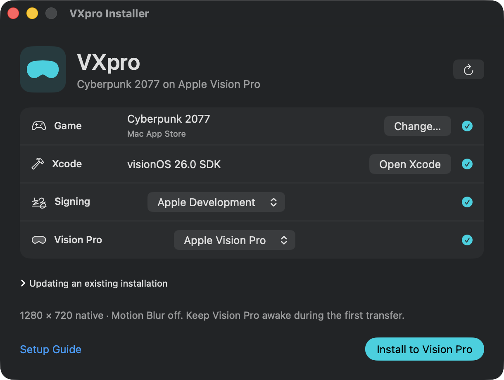

# VXpro

**Mac App Store版『Cyberpunk 2077』を、Apple Vision Pro単体でVRプレイ。** Macは初回セットアップに使います。

[Mac用ダウンロード · GitHub Releases](https://github.com/Ag3497120/VXpro/releases) · [実機デモ](https://youtu.be/Tn9hQm-S7Ho) · [Discord](https://discord.gg/h2znwYJt3) · [English](README.md)

<p></p>

ゲームのネイティブARM64コードをMach-O互換レイヤー経由で実行します。Metalで深度を取得し、ARKitで追跡した手をゲーム既存のボーンへ反映します。移動とボタン入力はJoy-Conで操作します。**＋と−を同時に1秒長押し**すると、プレイ中にコントローラー操作と手の追跡を切り替えられます。

## Macからインストール

<p></p>

インストーラーはプレビュー段階です。公開時にはDMGを[Releases](https://github.com/Ag3497120/VXpro/releases)に掲載します。[ソースからのセットアップ手順](docs/VISION_PRO_CYBERPUNK_MAC.md)は利用できます。

1. Appleシリコン搭載Macに、購入したMac App Store版のゲームと、visionOS SDKを含むXcode 26以降を用意します。Xcodeで有料のApple Developer Programチームにサインインし、必要ならApple Development証明書を作成します。
2. XcodeでVision Proをペアリングし、デベロッパモードを有効にします。ヘッドセットには2.5.0で約85GB、全音声を含む2.3.2で約160GBの空きを確保します。
3. VXproでチームと端末を選択し、**Install to Vision Pro**を押します。ゲームの準備、VX Mac Hostの署名、1280×720ネイティブ・モーションブラーオフの適用、転送とファイルサイズ照合を行います。

既存のインストールは自動検出されます。更新には従来のバンドルIDと署名チームを使ってください。更新前にゲームを保存し、VX Mac Hostを終了してください。

<details>
<summary>手の追跡と既知の問題</summary>

### 現在の到達点

ARKitの手・手首の追跡を、独自のMetal描画処理でゲーム既存の腕・手・銃のボーンへ反映します。
移動、発射、その他のボタン操作にはJoy-Conを使います。武器ごとの互換性確認を続けている実験版です。

- **プレイ中の操作切り替え：** Joy-Conの**＋と−を同時に1秒長押し**し、次の切り替え前に両方を離します。
  単独押しはメニュー操作です。切り替え時に合成した押下を解除し、コントローラーモードでは通常の武器描画と
  リロード処理へ戻します。実機で切り替えが動作すると確認を得ています。
- **メニュー表示：** クイックメニューの切り替え中も、ロード／セーブ画面と同様に一枚の表示面を使います。
- **近接攻撃：** 近接武器を装備して手を振ると攻撃します。一部武器の握り位置は未解決です。

- 武器は右手で保持し、ZRで発射します。長い銃はZLを押している間、左手の支持と照準を要求し、離すと解除します。
  支持よりも装填操作を優先します。
- Xで弾倉排出を要求します。ゲームの装備・弾数と連携する仕組みで、弾倉取得・挿入、ハンドガンの手動スライド、
  ハンドガン以外の自動装填を扱います。対応する私用オーバーレイをアプリへ埋め込めますが、公開するのは独自スクリプトと
  コンパイル用ツールであり、ゲームから作ったコンパイル済みキャッシュは含みません。
- 手と銃には容量を制限した独立GPUバッファで補正をかけ、ゲーム側の元の描画データを保持します。
- 今回の揺り戻し対策は、描画する画像の視点と画角をMetalの同じコマンドバッファへ保存し、表示側でまとめて使う方式です。
  徒歩で頭を左右へ向けて止める実機確認について、利用者から「完全に治りました」と確認を得ています。
- 通常VRだけで従来の外周補完を使うように戻し、通常画面の欠けの解消と、揺り戻しが再発していないことを
  利用者の実機確認で確かめました。続く11月9日の更新では乗車中にも適用しています。
- 11月9日の更新で不正なワールドカメラの採用を止め、試した場所でVR時の暗転が出なくなったと確認を得ました。
  乗車中にも外周補完を適用し、旋回入力を分けて扱います。上下の視点は頭だけで操作し、アクセル・ブレーキ・旋回の
  入力経路は維持しています。インストール後、利用者から「よくなりました」と確認を得ました。
- 追加設定でCDPRへ直接ログインし、クラウドセーブの表示・ロードを実機確認しました。起動時のログイン復元も含みますが、
  他機へのアップロード往復と、すべてのセーブへの対応は確認中です。
- **残課題：** 一部のストーリー・制約付き視点では四角い枠が残る可能性があります。全車種・全場面は未確認です。
  武器ごとの支持間隔、サイト／スコープの接続、装填・スライドの見え方にも調整と確認が必要です。
  袖の分離、一部近接武器の握り、スコープレンズの分離は残っています。ハンドガン横の余分な指は最新の確認で
  解消したとの報告がありましたが、それ以外の表示問題を修正済みとはしていません。
  銃口方向への弾道接続は引き続き実験段階です。

</details>

## FPSの到達点

M2での**60秒間の計測で、新しいゲーム画像が平均37.1 FPS**でした。利用者によるとPhantom Liberty内のセッションです。
ゲーム提出カウンタは別の集計区間で37.0 FPSでした。単一セッションの平均であり、全場面の最低値ではありません。
今回の視点修正より前の計測です。**45 FPSは次の目標で、達成済みではありません。**

フレームの投入間隔、保持画像数の制限、ワープ待機の解放、必要時だけの履歴コピー、比較・計測ツールを含みます。
実機で確認したハンド版の保持枠は4です。追加設定と確認範囲は[リリースメモ](docs/RELEASE_2026_11_08.md)を参照してください。

装着中は録画より滑らかに感じるとの報告もあります。Apple側の再投影などが寄与する可能性はありますが、原因や実際の
表示周期は確定しておらず、ゲームFPSへ加算しません。NPU・重み編集・フレーム生成の実験用ツールも含みますが、
計測構成ではモデルを有効化しておらず、NPUによるFPS向上は確立していません。

操作・実装：[HAND_SESSION.md](HAND_SESSION.md)、[設計メモ](docs/DESIGN.md)。
現在の修正・設定・確認範囲：[2026-11-09チェックポイント](docs/RELEASE_2026_11_09.md)。
最新の統合内容・検証範囲：[2026-11-10更新](docs/RELEASE_2026_11_10.md)。
過去のFPS計測：[2026-11-08リリースメモ](docs/RELEASE_2026_11_08.md)。
追加のアカウント・クラウド接続：[DIRECT_CLOUD.md](DIRECT_CLOUD.md)。
実験：[画像管理](FRAME_PIPELINE.md)、[NPUオフロード](NPU_OFFLOAD_RESULT.md)、[重み編集](NPU_WEIGHT_EDIT.md)。

<details>
<summary>画質が劣化した場合の復旧設定</summary>

### 画質の劣化・頭を回したときに映像が流れる場合の復旧設定

画質設定を変更した後に、映像がぼける、頭を回すと強く流れる、動作が重くなる場合は、ゲーム内の
**「ビデオ／グラフィック」設定**も確認してください。アプリを更新・以前の版へ戻しても、
アプリ内に保存された設定が自動で元に戻るとは限りません。

11月8日の調査では、次の違いを確認しました。アプリを変更せずに低負荷の設定へ戻した後、
利用者から、画質と頭を動かしたときの見え方が以前の状態へ戻ったと確認を得ています。

| 項目 | 不調時に確認した値 | 復旧用の設定 |
| --- | --- | --- |
| 出力解像度 | 1280×720 | **1280×720 ネイティブ** |
| 解像度スケーリング／動的解像度／フレーム生成 | 設定監査時の起動ではオフ | **すべてオフ** |
| モーションブラー | 高 | **オフ** |
| フィルムグレイン／色収差／被写界深度 | オン | **すべてオフ** |
| テクスチャ品質 | 高 | 低 |
| スクリーンスペース反射 | ウルトラ | オフ |
| アンビエントオクルージョン／コンタクトシャドウ | 高／オン | オフ／オフ |
| シャドウメッシュ／カスケードシャドウ／遠方シャドウ | 高 | 低 |
| ローカルシャドウ | 高 | オフ |
| ボリュームフォグ／ボリュームクラウド | ウルトラ／ウルトラ | 低／オフ |
| サブサーフェススキャタリング／最大動的デカール／LOD | 高／ウルトラ／高 | 低／低／低 |
| カラー精度／異方性フィルタリング | 高／16倍 | 中／4倍 |
| ミラー品質／群衆密度／顔のタンジェント更新 | 高／高／オン | 低／低／オフ |
| 視野角（FOV） | 110 | 110を維持 |

**MetalFXだけが原因と確定したわけではありません。** 設定監査時はMetalFXの品質欄に`Quality`が残っていましたが、
`ResolutionScaling`は`Off`で、実際のテンポラルスケーラー処理も記録されていませんでした。
復旧したファイルでは品質欄が`Performance`ですが、スケーリングがオフならこの欄は使われません。
**MetalFX Performanceを有効にする、という復旧方法ではありません。** 別の先行記録では、出力1280×720に対して
内部画像が**853×480**になっていました。出力解像度の表示だけではネイティブ描画かを判断できません。

まずゲーム内メニューで上記の設定に戻してください。外部から編集する場合は、ゲームを保存・終了してから、
ホストのアプリ内にある自分の`Library/Application Support/CD Projekt Red/Cyberpunk 2077/UserSettings.json`を退避し、
グラフィックと群衆密度だけを変更します。その他の設定、セーブ、アカウント情報は保持し、再起動後に設定を確認してください。
画質のリセットのためにVX Mac Hostを削除しないでください。

これは**復旧用の基準であり、過去の37.1 FPS測定時の全設定の記録や、同じFPSを保証するものではありません。**
設定復旧後もVR時だけの暗転は残り、[11月9日のチェックポイント](docs/RELEASE_2026_11_09.md)にあるカメラ側の修正で
別途対処しました。乗車・ストーリー中の枠も、設定だけで解消したと判断しないでください。
開発時の確認記録：`20261108T125547Z-graphics-settings-audit-restore/o1,o2,o3,o5`、
`20261108T214855Z-graphics-restored-vr-camera-preflight/d1`。生ログや個人の設定ファイルは配布しません。

</details>

## プレイ中の操作切り替え

**＋と−を同時に1秒長押し**します。アプリの再起動やセーブの再ロードは不要です。
次の切り替え前に両方を離してください。発射や支持のボタンも離すと、新しい方式へ入力を渡します。
通常のコントローラー操作から開始する場合は、起動時に `--env VXMAC_CONTROL_MODE=controller` を指定できます。

ゲームへの入力は片方の方式が担当し、装備中の武器と実際の弾数を保持します。切り替えで弾を補充することはありません。
押下の解除、ゲームスクリプトとの引き継ぎ、通常の描画バッファへの復帰、繰り返し切り替えをローカル検証しています。
すべての武器・装填状態・乗車場面の組み合わせは引き続き確認が必要です。

<details>
<summary>ソースからの導入と開発用オプション</summary>

### 最新版を取得する

```sh
git clone https://github.com/Ag3497120/VXpro.git
cd VXpro
```

以下の基本手順で、自分が購入したゲームを準備します。ハンド操作は実験的な追加設定です。
設定項目と対応する手動リロード用オーバーレイは[設計メモ](docs/DESIGN.md)の追跡ハンドによる武器保持の節を参照してください。
ソース更新後はXcodeプロジェクトを再生成してください。

実機で確認した武器別の接続には、**所有するゲームからローカル生成した数値カタログ**を使っています。
ゲームのメッシュ、抽出メタデータ、コンパイル済みオーバーレイ、モデルの重み、ビルド済みゲームホストはローカルに保存します。
`tools/weapon_asset_catalog.py` は、外部バッファまで展開済みの自分のCR2Wメッシュから
`build/hand-session-v2/weapon_asset_catalog.h` を生成できます。展開用の外部ツールは同梱しません。
このカタログがなくてもソースは既存の汎用処理でビルドできますが、確認済み実機と同じ武器別の接続にはなりません。
ローカル検証は `sh tools/check_hand_session.sh` で実行できます。

> 以下のPreview 0.3の説明は元のコントローラー版の記録です。最新の操作・計測範囲は上記とリリースメモを参照してください。

### 基本ランタイムとセットアップ

Apple Vision Pro で Mac App Store のゲーム（Cyberpunk 2077）を VR で動かします。頭の向きで視点操作、深度による再投影、
Neural Engine による中心窩アップスケーリング。無料、MIT ライセンス。

[English](README.md) · [日本語](README_ja.md) · [简体中文](README_zh-Hans.md) · [繁體中文](README_zh-Hant.md) · [한국어](README_ko.md)

VXpro は **Mac App Store 版 Cyberpunk 2077** を **Vision Pro 単体で** 動かします。Mac 版のゲームは visionOS と同じ
arm64 の Metal コードなので、ネイティブに動きます（エミュレーション、変換、ストリーミング、PC はいずれも不要）。ホスト
アプリ（VX Mac Host）がゲームのコードを読み込み、ゲームが使う macOS 専用ライブラリを小さなシムで置き換え、映像を
イマーシブ空間に表示します。3D のゲームプレイ中は頭の向きでゲームのカメラが回り、各目の映像はゲームの深度から 90 Hz で
再投影されます。メニュー、ムービー、ロード画面は部屋に固定されたパネルに出ます。

**状態：Preview 0.3**（実験的、2026-11-01）。M2 の Vision Pro で、設定を下げた状態で、メインメニュー、キャラクター作成、
ゲーム冒頭が動いています。ゲームは約 20〜30 fps、表示は 90 Hz の再投影です。

### Preview 0.3 の変更点

- **長時間プレイでの落ちを修正。** オーディオ HAL の経路を既定でオフにしました（`VXMAC_AUDIO_HAL=1` で元に戻せます）。
  ヘッドセットでの比較では、修正前は 51 分でアプリが 8 GB のメモリ上限近くまで増えていましたが、修正後は約 5.8 GB で
  横ばいでした。
- **推奨解像度は 1280x720 ネイティブ、FOV 110。** 1600x900 より明らかに滑らかです（M2 の戦闘中で約 11 → 17 fps）。
- **エイムの修正**：エイム（ADS）中や横移動中に乗り物モードへ誤って切り替わらなくなりました。ピッチが固まって下を
  向けなくなる問題を修正しました。ピッチのずれはリセットされ、トラッキングを失った間は頭の姿勢を保持します。
- **新しい実験的オプション**（既定はオフ）：`VXMAC_AIM=1`（ワープモード 7）、`VXMAC_GPU_CAP_HALF=0.85`、
  `VXMAC_INTERP=vel`／`=1`、`VXMAC_PASS_PROFILE=1`（ガイドの「オプション」参照）。

VXpro は [VeRantyx](https://github.com/Ag3497120/VeRantyx) の Mac App Store ルートです（Windows / Steam ルートの
VXRuntime は VeRantyx 側にあります）。

### 必要なもの

> **ゲームの版について：** Cyberpunk 2077 **2.5.0**（Mac App Store の最新の更新。App Store ではバージョン **1.0.4** と表示されますが、これは App Store 独自の番号で、中のゲームは 2.5.0 です）と **2.3.2** に対応しています（どちらもヘッドセットで確認済み）。英語音声は含まれます。ほかの言語の音声にはその音声アーカイブが必要で、2.5.0 ではまだ対応していません（2.5.0 のほかの言語の音声は Apple がホストするダウンロードです）。字幕とメニューは全言語で動きます。

- **Apple Vision Pro**（デベロッパモード、Mac とペアリング済み、空き容量は 2.5.0 で **約 85 GB**。データが約 80 GB。全言語の音声を含む 2.3.2 は約 160 GB）
- **Apple シリコンの Mac**、**Xcode 26**（visionOS SDK）、`xcodegen`、Python 3
- **自分の有料 Apple Developer Program アカウント**（アプリには Increased Memory Limit と Extended Virtual
  Addressing のエンタイトルメントが必要で、自分のチームで署名します）
- **自分で購入した Mac App Store 版 Cyberpunk 2077 バージョン 2.5.0 または 2.3.2**（Mac にインストール済み）

### はじめかた

```sh
tools/vxmac_cyberpunk.py doctor  --game "/Applications/Cyberpunk2077.app"
tools/vxmac_cyberpunk.py prepare --game "/Applications/Cyberpunk2077.app" --team <自分のTEAM_ID>
tools/vxmac_cyberpunk.py build && tools/vxmac_cyberpunk.py install
tools/vxmac_cyberpunk.py copy && tools/vxmac_cyberpunk.py launch
```

各ステップの内容、操作、オプション、トラブルシューティングは完全版のガイドへ：
[docs/VISION_PRO_CYBERPUNK_MAC_ja.md](docs/VISION_PRO_CYBERPUNK_MAC_ja.md)。仕組みと経緯（英語）：
[docs/DESIGN.md](docs/DESIGN.md)。

ヘッドセットでは、自動の切り替えが間違っているときに **両手で同時に 1 秒ピンチして離す** と VR と世界に固定した
スクリーンが切り替わります。**終了するには両手のピンチを 3 秒続け、「終了しますか？もう一度両手でピンチ」と出たら
もう一度両手でピンチ** します。ゲーム自身の終了処理（Mac の Cmd+Q と同じ）で終わり、アプリも閉じます。VR 中に **片手で 1 秒ピンチ** すると warp モードが切り替わります。詳しくはガイドの
「ヘッドセットでの操作」を参照してください。

> **VX Mac Host をヘッドセットから削除しないでください**：ゲームデータの複製（約 80 GB）とセーブが消えます。
> **こまめにセーブしてください**：ゲームは visionOS のメモリ上限近くで動いています。

### VXpro がしないこと

- **ゲームのファイルも、ゲームから作ったものも配布しません。** 自分のコピーを自分の Mac で準備し、自分のチームで署名し、
  自分のヘッドセットにだけ複製します。ビルドしたアプリにはゲームのコードが入っているので共有しないでください。
- **DRM、StoreKit、所有確認を回避しません。** App Store のバンドルに書き込まず、レシート、StoreKit、Game Center、
  iCloud、GOG のアカウントにも触れません。自分で購入したコピーを、自分のためにだけ使ってください。
- **CD PROJEKT RED とも Apple とも無関係です。** Cyberpunk 2077 は CD PROJEKT S.A. の商標です。Apple Vision Pro、
  visionOS、Mac App Store は Apple Inc. の商標です。

### 既知の問題（Preview 0.3）

- 終了は両手ピンチ（3 秒＋もう一度）か、アプリのウインドウの **Quit game** ボタンで。アプリを直接閉じるとゲームは
  一時停止し、10 秒後に終了を求めますが、バックグラウンドでは終了しきれないことがあります。セーブ中に強制終了はしないでください。
- ヘッドセットが熱くなったり、ワープがフレームに間に合わないと、表示が約 45 Hz に固定されることがあります：ヘッドセットを
  冷ましてください。
- 2.5.0 のほかの言語の音声はまだ対応していません（英語音声は動きます。字幕とメニューは全言語）。
- 推奨：16:9、**1280x720 ネイティブ**、FOV 110（`fov --max 110` と `settings`。ガイド参照）。
- ゲームデータの最初の複製は大きく時間がかかる（2.5.0 で約 80 GB）。
- App Store には提出しませんが、有料の Apple Developer Program が必要です。理由は 2 つのエンタイトルメントです。**Increased Memory Limit** がないと visionOS がアプリを約 5 GB に制限し、6〜8 GB 使うゲームはロード中に止められます。**Extended Virtual Addressing** は、ゲームが最初にとても広い仮想メモリの範囲を確保するために必要です。私たちの知る限り、無料（Personal Team）のアカウントではこの 2 つに署名できません（自分たちでは未確認なので、試した方はぜひ教えてください）。無料の署名は 7 日ごとに期限も切れます。

### 既知の制限

- **フレームレート**：ゲームは約 20〜30 fps。頭の動きは 90 Hz の再投影で滑らかですが、速い振り向きや動く物体では低い
  フレームレートが見えます。
- **HUD**：四隅（ミニマップ、クエスト、体力）がフレームの端にあり VR では見えにくいです。`VXMAC_HUD=1` またはゲームの
  HUD セーフゾーンで改善します。
- **下の縁**：ゲームのフレームは目の視野より狭く、残り（主に下側）はシーンの少し古いパノラマを暗くしたもの
  （`VXMAC_VR_CACHE`）で埋めています。ライブの映像ではありません。
- **メモリ**：アプリが使える約 8.2 GB のうち約 6.5 GB。設定を上げるとアプリが終了することがあります。
- **確認済みのビルド** 2.5.0 と 2.3.2（ハッシュで確認）。元のプレビューはオフライン専用でしたが、現在は追加設定で
  CDPRのクラウドセーブへ直接接続できます。Game Center／iCloud同期は未確認です。レイトレーシング、HDRは未対応です。
  プロファイルの期限が切れたら開発用署名をやり直します。
- Neural Engine の機能は組み込み済みですが **既定ではオフ** です：`VXMAC_FSR=1`（中心窩の超解像）、
  `VXMAC_FOVEATE=1`（コンポジタのフォビエーション）。ほか：`VXMAC_VEL`、`VXMAC_NPU`、`VXMAC_VR_CACHE`、
  `VXMAC_VR_VIGNETTE`、`VXMAC_VR_ZOOM`、`VXMAC_STICK_PITCH`（ガイドの「オプション」参照）。
- **視線追跡フォービエーション（ETFR）は現在無効です。** 表示側の試作では現在の描画経路でFPS改善が得られず、
  ゲーム描画側への適用は今後の最適化課題です。ETFRやNPUでのFPS向上を達成済みとはしていません。

</details>

## 安全について

VX Mac Host はサンドボックスではありません。ゲームのコードはアプリの権限でネイティブに動きます。自分が所有し信頼する
ソフトウェアだけを動かしてください。VR は体調に影響することがあるので、休憩を取ってください。

## ライセンス

MIT（[LICENSE](LICENSE)）。第三者の表記：[THIRD_PARTY_NOTICES.md](THIRD_PARTY_NOTICES.md)。
一人の開発者が AI コーディングエージェントと作っています。コミュニティ：[VeRantyx](https://github.com/Ag3497120/VeRantyx)。
